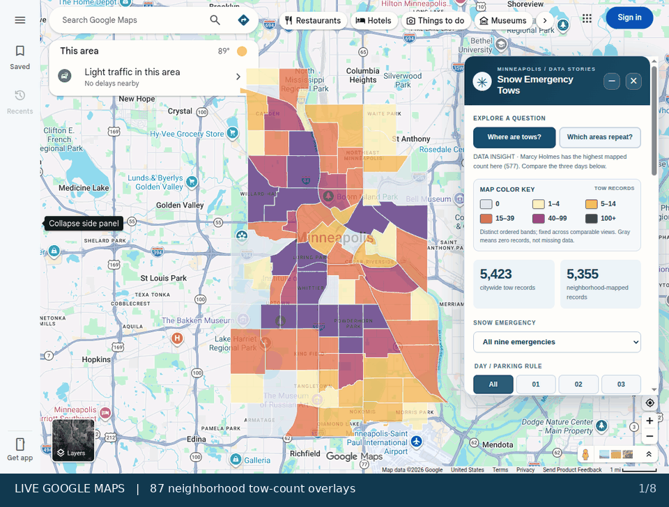
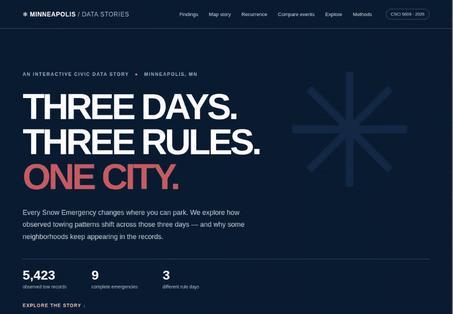
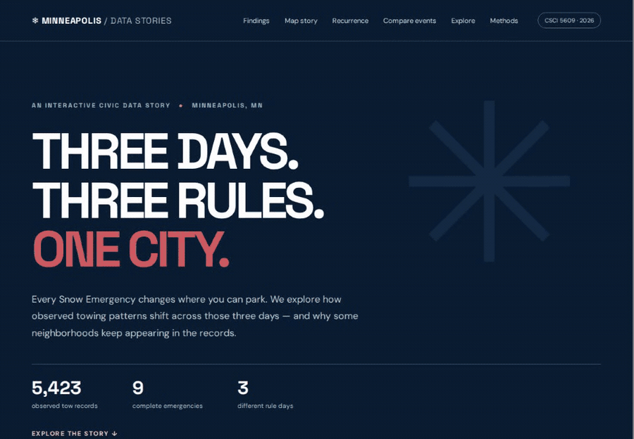
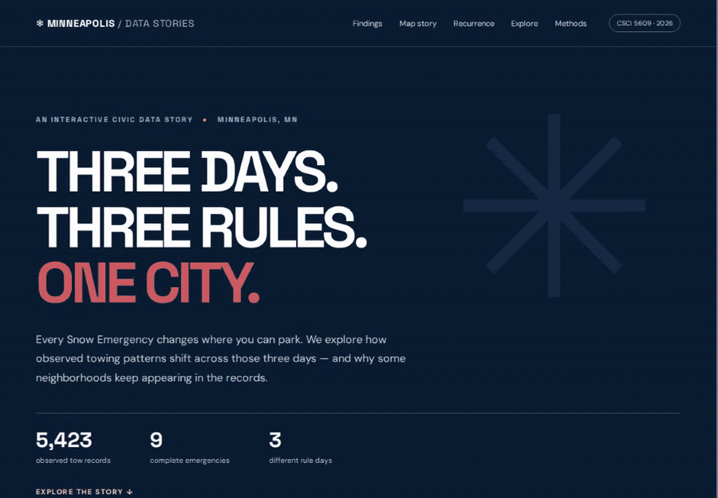
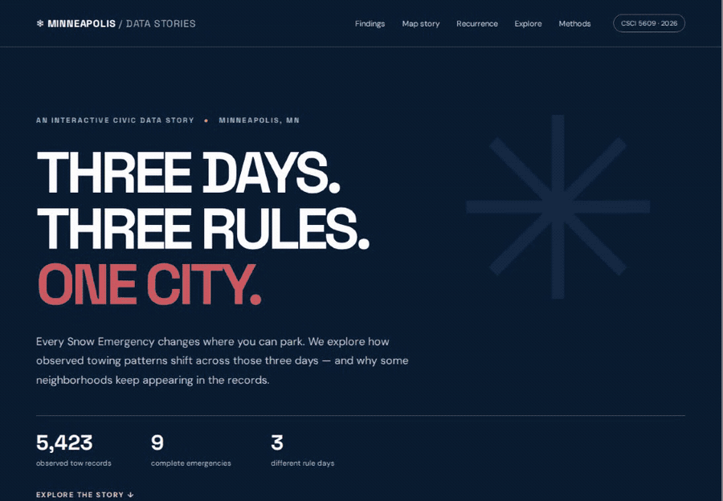
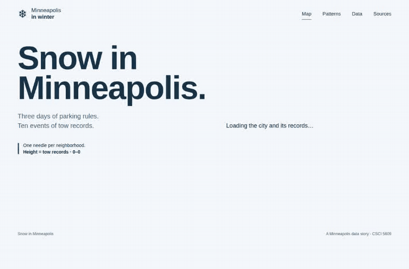

# Three Days, Three Rules

**[▶ OPEN LIVE INTERACTIVE PUBLIC DEMO](https://qinyangtan.github.io/minneapolis-snow-emergency-tows-demo/)**  ·  [Compiled public release repository](https://github.com/QinyangTan/minneapolis-snow-emergency-tows-demo)

**Visualizing Minneapolis Snow Emergency Tows** · CSCI 5609 Final Project

An interactive, evidence-driven visual story about how Minneapolis towing patterns change between Snow Emergency Days 1, 2, and 3, and which neighborhoods repeatedly appear or rank prominently across separate emergencies.

## See the Google Maps Extension in action (GIF)

**Watch the extension run directly on the real Google Maps website:** observed tow-count choropleth, Day 1–3 comparisons, neighborhood recurrence and interactive map navigation. This is a Chrome/Edge extension demo; the separate [live project website](https://qinyangtan.github.io/minneapolis-snow-emergency-tows-demo/) remains accessible without an extension.



**Captured from actual `google.com/maps` with the Chrome MV3 extension loaded (no substituted map pages).** The GIF shows count colors and legend, Day 2 event filtering, neighborhood inspection, cross-event recurrence/Top K, nine-event fingerprints, and native Google Maps zoom/pan. Short cuts between genuine captured UI states are video editing, not simulated map data. [Installation & methodology](extension/README.md) · [Run the standalone interactive story](https://qinyangtan.github.io/minneapolis-snow-emergency-tows-demo/).

**Status (Oct 8, 2026):** LIVE public GitHub Pages demo with nine official ArcGIS event layers, linked analysis and six real browser GIFs. Public 1440px desktop and 390px mobile Chromium verification passed, and the source CI had 14/14 browser E2E tests plus a GitHub Pages subpath smoke test passing. Still required for final course submission: real participant evaluation, manual screenreader review, team sign-off and course reports.

## Research-grade analysis and accountability

This is a **descriptive interactive data story**, not a live parking predictor. The application answers three distinct questions using different evidence: day-by-day patterns, neighborhoods with recurring **prominence** (not just presence), and variation between distinct Snow Emergencies. See [method and submission-readiness matrix](docs/RUBRIC_TRACEABILITY.md) for evidence, explicit limitations, and the verified Fall 2026 CSCI 5609 Canvas rubric.

The recurrence matrix reports both *ANY RECORD* (one or more tows) and *PROMINENT* (top 5/10/15 neighborhoods by observed event-specific tows, with at least five records, retaining cutoff ties). The selector lets readers assess threshold sensitivity. Event comparisons use a symmetric 0–1 Jensen–Shannon divergence of either three-day shares or mapped neighborhood shares; each mode states its denominator. **Neither descriptive measure establishes towing risk or causation.**

For a larger team, maintain [verifiable contribution records](docs/TEAM_CONTRIBUTIONS.md), mutually review all analytical claims, and confirm the required [AI contribution disclosure](docs/AI_DISCLOSURE.md) before submitting to the course.


**Usability study (new):** The [moderated facilitator kit](docs/USER_EVALUATION_SESSION_KIT.md) provides six unbiased participant tasks, exact answers grounded in the official City data, a [blank TSV observation sheet](docs/evaluation/evaluation-template.tsv), and an offline aggregation script. Use `npm run evaluation:report -- /path/to/private-study.tsv` to summarize only genuinely recorded anonymous outcomes. No participants have been evaluated yet. This is not a claim of real-user success.
## Optional Google Maps browser overlay (experimental)

A new [Chrome/Edge Manifest V3 extension](extension/README.md) can show the project's observed tow-count choropleth **on top of the desktop Google Maps website**, together with an event/day selection panel. It bundles our own 87-neighborhood City GeoJSON offline and requests only `activeTab` + `storage`; it does not require a Google Maps API key.

**Alignment is a preview, not a guarantee:** the overlay projects from the map's visible URL camera, not an official Google Maps extension projection API. It automatically hides polygons when camera coordinates, north-up 2D orientation, or map bounds are unavailable. See [installation and QA limitations](extension/README.md); the [standalone story](https://qinyangtan.github.io/minneapolis-snow-emergency-tows-demo/) remains the authoritative geographically self-contained visualization. Browser-extension source is independent of the course's FP1 PDF submission.

## Official course milestones

The Canvas connector was restored October 7, 2026 and the **actual Fall 2026 FP1–FP4 rubrics** were checked. See [milestone scores and deadlines](docs/RUBRIC_TRACEABILITY.md). FP1 requires a **7–10-minute PDF slide presentation by October 12**, while FP3 explicitly awards **2 points for a public GitHub Pages site**. The private source repo need not itself become public if an approved static demo is deployed separately. The [registered five-person team](docs/TEAM_CONTRIBUTIONS.md) must verify contribution ownership and [Codex/ChatGPT disclosures](docs/AI_DISCLOSURE.md). ChatGPT/GitHub commits are NOT course-funded Codex sessions.

## Editorial visualization gallery (current website)

The application now features **nine multi-attribute event fingerprint cards**, a **nine-by-nine symmetric event-similarity matrix**, and **top-5/10/15 recurrence sensitivity slopegraphs**. These complement the linked three-day neighborhood maps, recurrence count matrix, day signatures and detailed event inspector. All values are computed from the verified Minneapolis City aggregates, rather than fabricated examples.

The design decisions, alternatives, quantitative encodings, interactions, keyboard behavior and data limitations are documented in [VISUAL_STORY_REDESIGN.md](docs/VISUAL_STORY_REDESIGN.md). All six embedded GIFs below are recorded from the actual Chromium application and reflect tested interactions, not generated mockups.

## Course-grounded event constellation and coverage review

The new **Event Constellation** is a four-channel analytical plot developed after reading the CSCI 5609 lecture slides: quantitative x-position (Day 2's share of each event's *citywide* records), quantitative y-position (top-five neighborhood concentration among *mapped* records), proportional bubble area (event total), and hue (peak day). An equal-size mode reconfigures the encoding without changing the data; accessible event buttons link directly into all existing filters. The explicit citywide/mapped denominators prevent an especially tempting interpretation error. No population-level inference is made from nine selected emergencies.

The separate [lecture-by-lecture course alignment audit](docs/COURSE_ALIGNMENT_AUDIT.md) compares the authenticated Fall 2026 Canvas modules and real FP1–FP4 rubrics with concrete source/test evidence, marking gaps rather than claiming every lecture technique is implemented. It does **not** republish instructor slides. Real study outcomes, alternative sketches, team ownership confirmation and AI/Codex record requirements remain outstanding.

## Interpretable event comparisons and deployment readiness

The event JSD matrix now has a paired distribution view. Two colored points and an aligned axis show the actual **Day 1–3 shares**, or the **eight mapped-neighborhood shares with the largest percentage-point differences** between selected events. Each comparison displays its two denominators, the sign of the percentage-point change, and the citywide-vs-mapped scope — this makes the abstract similarity measure inspectable.

The [public GitHub Pages demo](https://qinyangtan.github.io/minneapolis-snow-emergency-tows-demo/) is now live; it is published from a separate repo containing **only compiled HTML/CSS/JS and City aggregates**, with a [verified project-path build and release checklist](docs/PAGES_RELEASE_READINESS.md). This development/source repo remains **Private**. A [real human usability/screenreader evaluation protocol](docs/USER_EVALUATION_PROTOCOL.md) is ready, but participation has **not yet been conducted**.

## Animated demos

### New · Multi-attribute event fingerprints

Compare nine event signatures — size, Day 1–3 proportions, strongest neighborhood count, and geocoding coverage — then select events to filter the story.



### New · Pairwise similarity across nine events

An interactive symmetric 9×9 Jensen–Shannon divergence matrix. Switch from day composition to mapped neighborhood composition and select any pair.


### New · Hotspot-threshold sensitivity

Compare neighborhood prominence at Top 5, Top 10 and Top 15 definitions; connect selected slopes back to the map explorer. These lines reflect a change of threshold, not time.



### Previous validated interaction demos


These GIFs are **recordings of real Chromium browser interactions** with the reproducibly processed Minneapolis City dataset. They are not generated illustrations or static mockups.

### 1. Three days, one comparable map scale

Inspect Day 1, Day 2, and Day 3 neighborhood concentrations side by side, with synchronized day highlighting and a shared scale.


### 2. Linked event, day, and neighborhood exploration

Filter to Bridge, select Day 2, click Marcy Holmes, and inspect the associated observed tow count — then reset the explorer.



### 3. Recurring neighborhood footprints and day signatures

Explore the neighborhood-by-event count matrix, choose a particular event and neighborhood, and sort 100%-normalized day profiles.



**Recording and validation:** `npm run qa:browser` tests desktop/mobile layout, linked filters, numerical reconciliation, keyboard actions, and automated WCAG serious/critical violations. `npm run demo:gifs` records actual Chromium videos before transcoding to looping GIF. The video-to-GIF conversion does not alter any underlying City data.

## Reproducible findings

Read [the frozen-data results and interpretation notes](docs/FINDINGS.md) before drawing conclusions from a screenshot. A central finding is that the closest pair of events **changes with the comparison lens**: Howard–Bridge for three-day composition, but Bridge–Glenwood for neighborhood distribution. The app computes these pairings directly from the saved City aggregates, using an explicitly defined divergence metric.

## Research questions

1. How do observed towing patterns vary by Day 1, Day 2, and Day 3?
2. Which neighborhoods repeatedly appear as towing hotspots across distinct Snow Emergencies?
3. How different are individual Snow Emergencies in day composition and geography?

## Scope

Nine complete three-day emergencies: Dover, Jane, Lourdes, Northrop, Victory 1 (2022/23); Howard (2024/25); Bridge, Glenwood, Jefferson (2025/26). The FP1 proposal reports **5,423** tow records, **independently re-confirmed** from official City layers on October 7, 2026 (all nine event counts match). Victory 2 is intentionally excluded because its published layer is incomplete.

- Study **observed towing records**, not probability of a particular vehicle being towed.
- Spatial claims primarily use neighborhoods rather than apparent address-level precision; City layers warn about approximately 8–14% geocoding-address error.
- No predictive model, backend, real-time tracker, St. Paul expansion, or demographic inference.

## Application

- **SvelteKit + D3**, ready for static deployment (not yet publicly hosted).
- **Python + requests + Shapely** data preparation; historical records are fetched from official ArcGIS FeatureServer endpoints, spatially joined to one neighborhood boundary definition, and exported as versionable summary JSON + GeoJSON.

### Run locally

Requires Node.js 20+:

```sh
npm install
npm run dev
```

The processed data is now committed: 5,423 citywide tow records, 87 neighborhood polygons; 68 geocoded points not located within a current neighborhood are retained in city totals but excluded from neighborhood map counts. If processed files are absent, the page explicitly falls back to the FP1 preliminary view.

### Regenerate data (network required)

Requires Python 3.11+:

```sh
python -m pip install -r requirements.txt
python scripts/build_data.py
python -m unittest discover -s tests -v
npm run check
npm run build
npm run qa:research
npm run qa:browser
```

The data pipeline fails loudly for ambiguous services, missing days, and invalid record geometry. Points outside the current City neighborhood polygons are retained in city totals, but excluded from neighborhood maps and disclosed in quality output. Inspect `static/data/quality.json` and review count differences from FP1 before using the generated maps as final evidence. The source-audit workflow publishes `static/data/summary.json`, `static/data/neighborhoods.geojson`, and `static/data/quality.json` only when all nine layer counts pass strict checks. It never exports raw address-level tow points.

## Project map

```text
src/routes/+page.svelte          Scrollytelling overview + linked filtering
src/lib/NeighborhoodMap.svelte  Keyboard-selectable D3 neighborhood choropleth
src/lib/DaySmallMultiples.svelte  Three comparable day maps with common legend\nsrc/lib/NeighborhoodMatrix.svelte  Event-by-neighborhood count matrix\nsrc/lib/DaySignatures.svelte  Normalized neighborhood composition\nsrc/lib/analytics.ts        Pure cross-view count/recurrence selectors\nsrc/lib/preliminary.ts      Clearly labeled FP1 fallback snapshot
scripts/build_data.py          ArcGIS acquisition / normalization / join / export
tests/                        Input and checked-in-output integrity tests
docs/DESIGN.md                 Storyboard, encodings, interaction, quality criteria
docs/DATA_CONTRACT.md          Schema, provenance and aggregation semantics
static/data/                   Generated public, aggregated data (not raw addresses)
```

## Official sources

- [Snow Emergency parking rules](https://www.minneapolismn.gov/getting-around/snow/snow-emergencies/snow-parking-rules/)
- [ArcGIS services directory](https://services.arcgis.com/afSMGVsC7QlRK1kZ/ArcGIS/rest/services/)
- [Minneapolis neighborhoods](https://services.arcgis.com/afSMGVsC7QlRK1kZ/ArcGIS/rest/services/Minneapolis_Neighborhoods/FeatureServer)
- [Bridge tow event example](https://services.arcgis.com/afSMGVsC7QlRK1kZ/ArcGIS/rest/services/Snow_Emergency_Bridge_Tows_2025/FeatureServer)

The primary design authority is the team's *CSCI5609 FP1 Snow Emergency Proposal* (October 2026). Substantive AI/agent contributions must be reported in accordance with course guidance.

## Working agreement

Do not publish false-precision dot maps, mislabel observed counts as risk, silently discard unmatched records, or claim an FP1 preliminary count has been independently revalidated. Always show source, unit of analysis, time coverage, and limitations. No raw address-level export in the public app.

## Alternative winter 3D demo

**[▶ EXPLORE THE LIVE 3D WINTER CITY](https://minneapolis-snow-emergency-demo.vercel.app)** · [Standalone data story source](demo/README.md)

This separate Three.js visualization uses a **ten-event / 6,118-record** collection, *not* the nine-event / 5,423-record sample of the main SvelteKit story. It adds an audited Omega event; do not combine counts from the two views without making the event selection explicit. Needle height represents observed Count or within-neighborhood day Share, not snow depth or per-vehicle towing risk.

### Genuine interactive demo GIFs — recorded from Chromium

**Orbit the city** — freely rotate the real neighborhood geometry, then switch between top and angled views.


**Unfold three days** — reveal parallel views of the same city and compare daily counts with a shared scale.


**Compare two emergencies** — Bridge versus Howard, switching Count/Share and selecting the third day.



[Live 3D demo](https://minneapolis-snow-emergency-demo.vercel.app) · [Run locally](demo/README.md) · [Mobile screenshot](docs/screenshots/winter/mobile.jpg) · [Design review](docs/winter-design-review.md)

