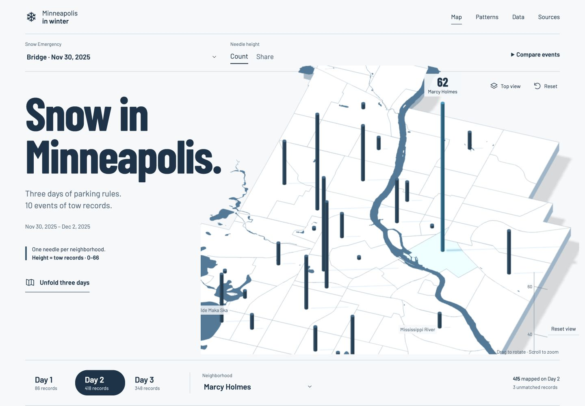
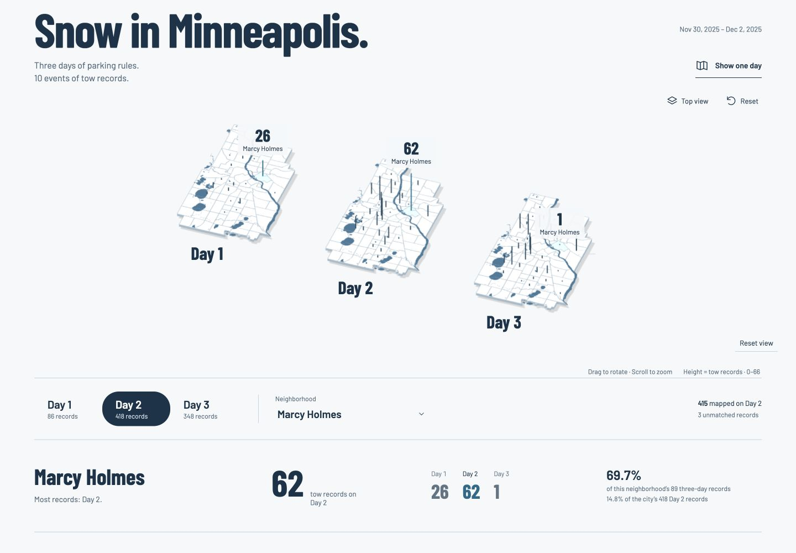

# Snow in Minneapolis

An interactive data story about Snow Emergency days and neighborhood tow patterns.

**[Open the live demo](https://minneapolis-snow-emergency-demo.vercel.app)**



Drag the city to rotate it. Scroll or pinch to zoom. Select a neighborhood, unfold the three days, or compare two events. Needle height shows tow count or the day’s share of that neighborhood’s three-day total.



## Run the demo

Node.js 22.12+ or 24+.

```sh
cd demo
npm ci
npm run dev
```

```sh
npm run check
npm test
npm run build
```

The standalone Svelte / Three.js / D3 demo lives in this directory. The original SvelteKit application remains in the repository root.

## Data

10 selected events, 2022–2025. 6,118 published tow records. 87 neighborhoods. 6,050 records match current City boundaries; 68 unmatched records stay in city totals.

Counts use the published Snow Emergency day. All events share a 0–66 count scale; within-neighborhood shares use 0–100%. These records describe historical towing, not individual tow risk or current parking conditions. NOAA MSP observations give station weather context, not neighborhood snowfall or causal evidence.

- [Event data and provenance](public/data/snow-emergencies.json)
- [Preparation notes](public/data/snow-emergencies-provenance.json)
- [All neighborhood counts](public/data/all-neighborhood-day-counts.csv)
- [City Snow Emergency rules](https://www.minneapolismn.gov/getting-around/snow/snow-emergencies/snow-parking-rules/)

Raw snapshots and preparation scripts are included in `data/` and `scripts/`. To check the data pipeline:

```sh
cd demo
python3 -m venv .venv
.venv/bin/pip install -r requirements.txt
.venv/bin/python -m unittest discover -s tests -p 'test_*.py'
```

## Screenshots

[Mobile](../docs/screenshots/winter/mobile.jpg) · [Compare events](../docs/screenshots/winter/comparison.jpg) · [Rotated city](../docs/screenshots/winter/rotated.jpg)

Captured from the production build on October 7, 2026. Desktop: 1440 × 1000. Mobile: 390px wide. [UI review](../docs/winter-design-review.md).
