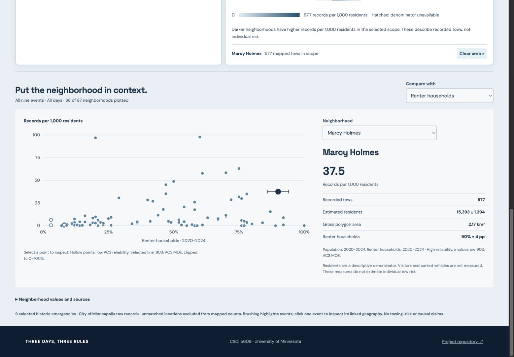

# Neighborhood context: local implementation verification

Date: November 10, 2026. Branch: `research/professor-feedback`. Source-data commit: `f54d514f01575a6da5b38e6e1c5b93ba50e7f2e8`.

## Implemented

- Published a 42,681-byte neighborhood context JSON and a 24,352-byte aggregate CSV. The site does not load the 1.32 GB research package or raw vehicle/property records.
- Added a shared Count / records per 1,000 residents / records per gross km² selector to the existing dashboard map and new context scatterplot.
- Connected event/day/neighborhood selection across the map, scatterplot, native neighborhood selector and exact-value table. Added renters, no-vehicle household and poverty context with indicator-specific ACS periods, MOE and reliability.
- Preserved all 87 map neighborhoods. Population data are available for 86; unknown ratios are hatched and unavailable rather than zero. Hollow scatterplot points denote low ACS reliability; the selected percentage shows its 90% MOE.
- Added source links, an all-nine-event CSV download, accessible data table and concise Methods scope. No ordinary-day baseline or excess count was invented.

## Verification

- `npm run check`: zero errors and zero warnings.
- `npm run qa:research`: 27 tests passed, including six new denominator, scope, missingness, shared-domain and public-data contract tests.
- Python `unittest discover -s tests -v`: nine data/pipeline tests passed after installing the project's existing Python requirements.
- `npm run build`: production static build passed without Svelte warnings.
- Research pipeline: 661 stored-file hashes and five decompressed-original hashes verified; 5,355 mapped records plus 68 unmatched reconcile to 5,423.
- Independent [code/data review](context-feature-review.md): no additional P1/P2 findings; verified all 258 published contextual indicators and all 86 population estimates against their source rows.
- Impeccable's active hook scanned the modified route, map and new component without deterministic findings. No separate manual detector loop was added after the active hook ran.

## Browser evidence

The production build was checked with the supported browser UI at 1440×1000 and 390×844.

| Scenario | Observed result |
|---|---|
| All events, Marcy Holmes, resident denominator | 577 records / 15,393 estimated residents = 37.5 per 1,000 |
| Bridge, Day 2, same population | 62 records; map value 4.027804846358734 per 1,000 |
| All events, Marcy Holmes, gross-area denominator | Map value 266.30131390301966 records/km² |
| Poverty context | 2019–2023 source period retained alongside 2020–2024 population |
| Enter on South Uptown scatterplot point | Shared selected neighborhood changed to South Uptown |
| Humboldt Industrial Area, resident measure | Missing map value; raw count remains zero; no `Not available%` label |
| Armatage, resident measure | True zero remains a zero value rather than missing |
| Reset | Restores Count, renters and no selected neighborhood, plus existing event/day/brush filters |
| Mobile | 375px document content within 390px viewport; SVG axis text measured 15.5px high; table scroll stays inside its container and contains 87 rows |
| Context JSON 404 on a fresh localhost origin | Retry appears; all 87 count-map paths and Marcy Holmes count 577 remain available; contextual selector is disabled |
| Restore JSON and Retry | Context returns with 87 rows and enabled measure selector |

The first failure-injection attempt removed an asset while Vite Preview still indexed it, causing a preview-server read error. Files were restored. A later attempt reused browser-cached JSON. The actual 404/recovery check was therefore completed against a standard static server on a fresh localhost origin; no application code was changed to accommodate the test. Before intentional failure injection, the production page had no recorded console errors.

Screenshots: [desktop](../screenshots/context/desktop.jpg) and [mobile](../screenshots/context/mobile.jpg).

## Local preview and limits

Current built-site preview: http://127.0.0.1:5177/

To develop from the repository root, run `npm run dev`. The context public assets are already generated. To regenerate them, install `requirements-research.txt` in the research Python environment and run `python scripts/audit_professor_feedback.py`.

The site is still a selected-snow descriptive analysis. The all-date baseline, historical parking exposure and additional validated emergencies remain separate research work. Browser verification was focused on this extension; it is not a complete screen-reader/WCAG certification or a rerun of the entire existing Playwright suite.

At the November 10 verification checkpoint, changes remained local; no Commit, Push, deployment or external data request had been performed.

## Authorized publishing check · November 11, 2026

The user authorized checking, committing and pushing the local changes. Fresh checks passed: 27 JavaScript research tests, nine Python data/pipeline tests, and Svelte check with zero errors and warnings. The review also corrected the unselected map footer so its label follows the active Count/resident/area measure. This follow-up does not authorize deployment, merging to main or submitting external data requests.
