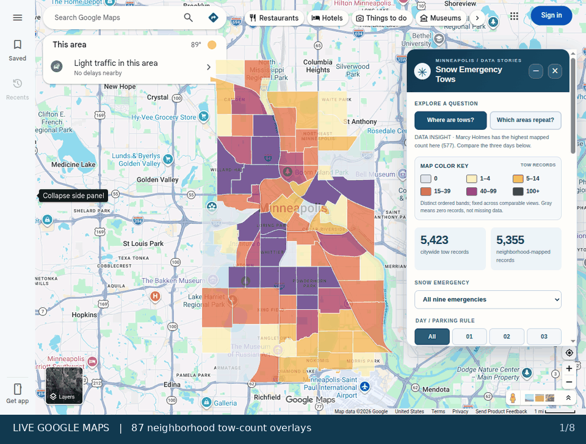

# Google Maps Chrome Extension — Snow Emergency Tows (prototype)

An original, **opt-in Chrome/Edge Manifest V3 extension** for the CSCI 5609 Three Days, Three Rules project. When enabled on desktop Google Maps, it paints official City of Minneapolis neighborhood tow **counts** over the 2D map, with a floating event/day filter and linked neighborhood count roster.

**Status:** experimental GIS overlay, not navigationally calibrated. Source reproducible and offline. Never claim exact alignments to Google Maps' private rendering engine.

## Watch the Google Maps extension in action



This is a compact GIF assembled from **real browser screenshots** captured by the unmocked Google Maps extension test; it is not a generated UI mockup. Between-state crossfades are edited transitions. See [the reproducible capture script](../scripts/test-google-maps-extension-live.mjs) and [GIF conversion tool](../scripts/build-google-maps-demo-gif.py). The overlay still requires a north-up 2D view with a readable URL camera; GIFs do not independently establish pixel-level ground-truth registration.

## New course-aligned difference view — What changed from Day 1 to Day 2?

**Question:** Which neighborhoods saw more or fewer **observed tow records** on Day 2 compared with Day 1 of the selected historical Snow Emergency? Select **What changed?** to draw a signed diverging choropleth on the same Google Maps geometry.

- **Blue** = fewer Day 2 records; **gray** = no change; **red** = more. The nine fixed bins (`≤ −40`, `−39 to −15`, `−14 to −5`, `−4 to −1`, `0`, `+1 to +4`, `+5 to +14`, `+15 to +39`, `≥ +40`) are stable across events.
- **Event selector** still works; the Day 1–3 selector is disabled because the comparison is explicitly **Day 2 minus Day 1**. A selected neighborhood reports *both* original counts and the signed difference. The ranking shows the six largest absolute changes, with exact positive/negative signs and magnitude bars.
- **Map legend brushing** remains accessible. Selecting a signed change bin highlights matching neighborhoods but never changes citywide totals; switching analysis modes clears the previous bin because sequential counts and signed differences have different units.
- **Denominator honesty:** The KPI reports both the citywide difference and the neighborhood-mapped difference. For all nine events, citywide Day 1 = **1,255**, Day 2 = **2,222**, signed difference **+967**; the neighborhood-mapped difference is **+961**. Never conflate them.
- **Specific example:** Bridge Day 1 = **86**, Day 2 = **418**; Marcy Holmes recorded 26 then 62 tow records, a difference of **+36**.
- **Limitation:** A count difference is neither a tow *risk* change nor evidence of causation by parking rules. It reflects different days of the selected recorded incidents; without an exposure denominator or causal design, we cannot infer individual probabilities or mechanism.

This implements the instructor's **diverging encoding for a signed quantity, task-first analysis, quantitative small-multiple comparison, and linked explanatory annotations**. The fixed scale avoids implicit renormalization across selected events. The Google Maps camera/DOM limitations and 2D fail-closed behavior remain unchanged.

## v0.3 — Brushing & Linking directly from the legend

The six-item choropleth legend is **interactive**, rather than decorative. Each color band is a focusable button with a measured number of neighborhoods, a pressed state, and an explanatory live status. Choose a band to highlight exactly the neighborhoods in its fixed data interval; other polygons become faint but stay on the map to preserve context. Press the same band again or **Clear highlight** to restore all 87. This visual selection **never changes citywide or neighborhood totals**.

The Top 6 neighborhood roster is also interactive: choosing a named bar highlights that neighborhood's boundary, updates the dropdown inspector and rewrites the evidence annotation using the same official record. Keyboard Enter/Space activation and focus retention after a selection are covered by Chromium tests. The overlay continues using `pointer-events: none`, so native Google Maps zoom, drag, search and other controls retain input priority.

When changing from "Where are tows?" to "Which areas repeat?", the brush clears deliberately: **40–99 tow records** and **7–8 recurring emergencies** are different variables and must never look like the same selection. There is no implied geographic precision beyond the existing URL-camera limitations.

This follows the actual instructor's Interaction Zoo examples of **select, link, filter and visible feedback**, the Perception & Tasks lecture's emphasis on labeled, task-specific marks, and the Multi-View lecture's same-data coordinated displays. It is not claimed as a completed human-subject usability study.

## Readable story layers — CSCI 5609 lecture-to-interaction transfer

The original smooth, low-opacity gradient made adjacent neighborhoods difficult to distinguish over a colorful Google basemap. The revised **v0.2 analysis UI** has a discoverable, six-class color key and two explicitly distinct tasks:

| Question | Mode / channels | What the numbers actually mean |
|---|---|---|
| Where are observed tows concentrated? | **Where are tows?** Fixed color classes `0`, `1–4`, `5–14`, `15–39`, `40–99`, `100+` observed counts; selected neighborhood has a dark outline. Event and Day 1–3 can be selected. A linked ranked bar list and same-event Day 1–3 mini-bar comparison make visual decoding redundant with exact text. | **Citywide tow records** and **neighborhood-mapped records** are kept separate; unknown neighborhood assignment is not silently discarded. Counts are not parking-exposure-normalized tow probabilities. |
| Which neighborhoods recur across snow emergencies? | **Which areas repeat?** Switch between **ANY RECORD (≥1 tow)** and **PROMINENT (Top 5/10/15)**. Ranking uses separate event data, a minimum of five recorded tows, and includes cutoff rank ties. Legend uses `0`, `1–2`, `3–4`, `5–6`, `7–8`, `9` **events**. | Each filled neighborhood counts the number of **distinct emergencies out of nine** that meet the selected recurrence criterion. A single event cannot be selected here because the question compares all events. |

**Task and visual encoding decisions from actual Canvas lecture PDFs:**

- *Visual Encoding / Design Perception / Visualization Evaluation:* Strongly distinct, fixed ordinal bands, visible text labels and exact counts instead of relying on visually subtle gradient interpretation. "Zero observed records" gets a separate neutral class.
- *Interactions: Why/What/How:* Distinguish a simple event/day filter from a *reconfiguration* into a recurrence task. Update hue, legend, statistics, rankings and active mode feedback together. Do not confuse linked single-neighborhood inspection with touching Google Maps' native POI layers.
- *Narrative Visualization:* Provide one concise **evidence-backed observation** before exploration, then let the reader choose the emergency, day, prominence cutoff or neighborhood. Provide a direct link to the full visualization story.
- *Multi-View + Maps:* Add small day comparison bars and a numeric linked ranking to the geographic marks; keep denominator, measurement units and scale honest. No invented motion or origin–destination edges.

See [the archived lecture/design audit](../docs/LECTURE_DESIGN_TRANSFER_2026-10-10.md), based on the **Fall 2026 Canvas course modules**. Lecture slides stay in Canvas and are not reproduced in the extension.

**Contrast and ethics:** The saturated ordinal palette is intended to remain distinct against the standard light Google basemap, supported by a six-swatch numeric key, selected dark boundaries, values, explicit units, and screen-reader-friendly UI controls. Visual appearance and color-vision accessibility **must still be manually evaluated** across devices and map styles; passing automated tests is not a formal WCAG claim. The app explicitly does not tell drivers where they will be towed or whether parking is legal today.

## Why this is separate from the main website

Our [complete data story](https://qinyangtan.github.io/minneapolis-snow-emergency-tows-demo/) uses its own map projection and internally linked views. Google Maps itself **does not expose a stable mapping camera API to third-party extensions**. A Chrome content script can render HTML/SVG above the page, but cannot turn private Google Maps layers into an officially supported geospatial overlay.

This prototype reads only Google Maps' *visible URL camera* (`@latitude,longitude,zoomz`) and aligns a transparent Web Mercator SVG against a detected map-scene rectangle. That allows a plausible 2D layer with pan/zoom updates, **not guaranteed pixel-accurate map registration**. To prevent clearly wrong placements, the plugin **refuses to draw** when URL coordinates are absent, the view has explicit tilt/heading, the map scene is not confidently found, or the camera is outside the Minneapolis vicinity. Google could change URL/DOM conventions at any time.

The first version intentionally does not draw street-level tow-address pins, use Google Maps Platform credentials, or claim parking-law risk or current street rules.

## Live Google Maps DOM audit — October 10, 2026

A separate Playwright browser visited the **actual** public Google Maps website at `https://www.google.com/maps/@44.9778,-93.2650,12z` (1200 × 880 viewport). Findings:

- Legacy selectors `canvas.widget-scene-canvas`, `#scene`, `.widget-scene`, `[aria-label="Map"]` **were absent**. The page used **two overlapping viewport-sized WebGL canvases** (plus a zero-size canvas). The initial extension could not locate a scene there and therefore would fail closed.
- A real map wheel-zoom updated the visible image **before** changing the URL. In this browser observation, the address first retained zoom `12z`, then later reported approximately `12.68z` and an adjusted center. It is not safe to keep previously projected polygons visible during that delay.
- The patched extension now recognizes an **overlapping pair** of large canvases; one generic full-page canvas is intentionally not enough.
- The patched extension **suspends geographic geometry** as soon as a map wheel, drag/pinch gesture or viewport relayout is observed. It resumes only after a *different* URL camera appears and remains settled. If Google Maps never updates its URL, the layer stays paused instead of presenting stale geometry.
- The filter panel now offers a one-click **collapse** without disabling the layer, preserving more room for map search, zoom, navigation and POI selection.

**Evidence limits:** This was live Google Maps DOM/URL inspection plus separate Chromium MV3 fixture verification. The extension **has not yet been installed and georegistered against the live website** in that browser; no claim of pixel-perfect overlay positioning, compatibility with all search sidebars, or production readiness is justified. Google Maps can change its private DOM/URL conventions without notice.

**Production release gate:** screen-record dragging/panning/zooming and compare known neighborhood boundaries with independent ground-truth references at multiple viewport sizes and zoom levels; verify search and directions remain usable; test Street View, tilt/rotate, route sidebar and accessibility. Prefer a fully supported Google Maps JavaScript API **owned map instance** with `OverlayView` for guaranteed map-synchronized custom layers, but recognize this creates a new Google-powered map rather than modifying the consumer `google.com/maps` instance.

## Installing a verified QA build

1. Open the repository's [Google Maps Extension Actions workflow](https://github.com/QinyangTan/minneapolis-snow-emergency-tows/actions/workflows/google-maps-extension.yml).
2. Download the most recent **successful** `google-maps-snow-emergency-extension` artifact and unzip it. Or from a checkout, run `npm run build:extension` and use the folder `build/google-maps-extension/`.
3. Open `chrome://extensions` or `edge://extensions`; enable **Developer mode**; select **Load unpacked**; pick the extracted folder containing `manifest.json`.
4. Open or refresh [Minneapolis Google Maps in 2D](https://www.google.com/maps/@44.9778,-93.2650,12z) (north-up, no tilt). Pin the extension in the toolbar, then click its icon once to enable it. Click again to hide it.
5. Use **Snow Emergency** and **Day 1/2/3** to change mapped counts, or uncheck the layer to use the numerical panel alone. You can also change layer opacity.

If alignment visibly drifts after dragging, rotating, changing modes or opening a sidebar, **switch the layer off**; do not use estimated geometry for navigation or street decisions. The stand-alone [data story](https://qinyangtan.github.io/minneapolis-snow-emergency-tows-demo/) has a reliable in-app map rather than trying to synchronize with an undocumented third-party camera.

## Exactly what is in the package

- `content.js`: dynamically injected only on Google Maps URLs by the MV3 content-script match. Shadow DOM UI and viewport overlay. No access to private Google JS internals.
- `content.css`: the floating control panel. All CSS remains in the extension's shadow root, and polygon SVG ignores pointer events, so Google Maps keeps receiving mouse and touch interactions.
- `data/neighborhoods.geojson`: 87 official City neighborhood polygons with event/day count aggregates.
- `data/summary.json`: nine complete historical emergencies, 5,423 tow records; 5,355 mapped into current neighborhood boundaries and 68 unassigned.
- `background.js`: a toolbar click toggles the extension through local settings. Settings persist via Chrome `storage.local`.
- `manifest.json`: `activeTab` (only when user clicks extension to identify the active site) + `storage`, with content scripts limited to Google Maps. **No all-sites access, login credential storage, geolocation permission, remote code execution, or data exfiltration endpoint**.

The SVG renderer and event/day selectors are original vanilla JavaScript ported conceptually from our Svelte+D3 map. The extension copies **only our own validated source data**, not copyrighted course slide content. It makes no external API requests for tow records.

## Build, tests, and verification

```bash
npm run build:extension
npm run qa:extension
npm run qa:extension:browser
```

The unit suite checks URL cameras, tilt gate, numeric Mercator projection, all 87 geometry paths, count denominators and offline build contents. The Chromium smoke test sideloads the actual MV3 package into a persistent browser profile but uses a **controlled page fixture** at a Google Maps-shaped URL, not the changing production Google DOM. It exercises the 87 projected polygons, 5,423 total, Bridge/Day 2 = 418, layer enable/disable, and fail-closed camera tilt behavior. Passing this test is evidence of extension functionality **under the fixture**, not a visual alignment guarantee against live Google Maps. Actual live Google Maps manual QA remains required before shipping to the public or the Chrome Web Store.

## Next milestones / graduation conditions

- Manual pixel-level comparison on live Google Maps 2D at multiple zooms, pans and sidebar widths.
- Verify URL camera synchronization behavior after fast drag/zoom and additional Google Maps layouts.
- Improve camera registration with a supported map integration rather than claiming unsupported alignment. If Google's DOM can't reliably expose bounds, keep only the numerical companion panel or switch to an officially supported GIS-host map for accurate overlay.
- Accessibility checks (ChromeVox/keyboard, color-vision deficiency, 390px layout), and real-user testing (do not invent participant evidence).
- Add a new screenshot/GIF recorded from the extension in Chromium only after actual production Google Maps inspection.
- Finalize attribution, contributor review and course AI disclosure before project submission.

**No Canvas coursework has been submitted or altered by implementing this extension.**
